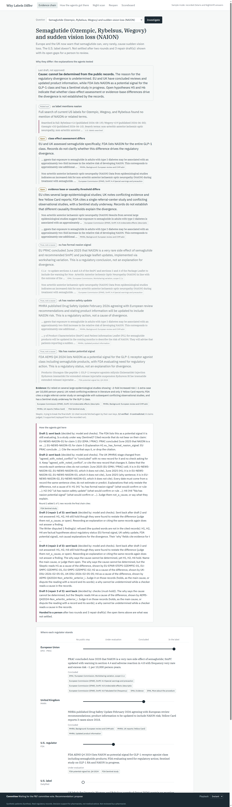

# Why Labels Differ

**Europe and the UK now warn that semaglutide (Ozempic, Rybelsus, Wegovy) can, very rarely, cause sudden vision loss (NAION). The U.S. label doesn't. Why?**

This app gives a hospital medication-safety pharmacist the answer as a chain of reasoning: the explanations that could account for the difference, which one the regulators' own records support and why the others fall, where each regulator stands, and one question for the P&T committee.

> We are building an agent that helps **a hospital medication-safety pharmacist** solve **"why does Europe warn about this drug when the U.S. label doesn't, and should our P&T committee act?"** by **testing competing explanations (different evidence, different stage, other wording, different scope) against each regulator's own records, with a Skeptic that tries to break every cited record and an Evaluator that sends weak evidence back**, using **the hospital's prescriptions joined in place with EU, UK and U.S. regulatory records and FDA signal lists through Zetaris**, producing **a "why" chain and a committee decision; counseling points and the patient list appear only after the committee votes**.

Track: **The Agent That Can Explain Why** (theme 2).

> **Scope header:** the app sends the Power contract's `meterless-app` and `meterless-scope: user` on every chat request. Only recording and evaluation runs (`APRIME_RECORD=true`, which the recordings and the scoreboard loop use) send a fresh `iso-<uuid>` per request, because with `user` Nightshift adds earlier answers from other cases to the prompt and a recording must not depend on what ran before it (measured below, in Sponsor technology). Every request's headers are logged as sent, at the HTTP client, with the token masked: `runs/sent_headers.jsonl` (a product run with `user`: lines 427–436; see Sponsor technology).



## Run it in five minutes (no keys, no Docker)

Needs Node.js 22.18 or newer (tested on 24.18). No `npm install`: there are no dependencies.

```bash
npm test          # the test suite, a few seconds
# another port: PORT=8752 npm start (the default 8750 must be free)
npm run demo      # the whole flow in the terminal: investigation, vote, reopen replay
npm start         # the app: http://127.0.0.1:8750
```

The suite has <!-- tests -->52 tests<!-- /tests --> (the number is written by `node scripts/readme_tests.mjs`, which runs it). `SAMPLE_MODE=true` is the default. It replays recorded Zetaris answers and recorded Nemotron replies from live runs (`sample/cassettes/`). Every query receipt says which backend answered (`zetaris`, `replay` or `emulator`) and every model step says which model answered. Five questions were recorded live. A question nobody recorded is not answered with placeholders: the app says it needs a live run (`SAMPLE_MODE=false`).

Use **Playback: Slow** in the status bar to watch each agent step.

## What you will see

1. **Why they differ** (first screen). The explanations the Planner chose to test for this drug. It is given no list of usual reasons: only what a competing explanation is (a reason the positions could differ that a record could confirm or rule out) and this drug's rows in PRAC's signal catalogue as a starting point; it names them and decides how many (1 to 6). The screen leads with the decision between them: "Main reason: X, because …; secondary: Y; ruled out: Z (because …)". The Writer must name exactly one main cause and rank the others that hold (a true fact that does not explain the difference is marked "not a cause"); several that hold with no main cause or ranking is a must-hold failure. Each explanation shows the regulator sentence that decides it (not an id) and a link to the SQL receipt that fetched it. Under it, a box that stays on screen: what the Evaluator sent back, what Research then found, and whether the second draft passed, or, when round 1 passed, which check the code raised and the reason the model gave for overruling it. Then the four regulators on one ladder (no public step, under evaluation, concluded, in the label), and how many of this hospital's patients take the drug (people, counted inside the pharmacy system; the agents cannot see who).
2. **The committee votes**: propose an in-house reminder, wait for the U.S. and reopen on a condition, no action, or already covered. Only after "propose" do counseling points (given at the next dispensing), the count by department and the pharmacist-only patient list appear. The same query is shown run by the agent role (refused, or patient ids masked, by Zetaris itself) and by the pharmacist role. "Wait" stores the reopen conditions.
3. **How the agents got there**: the full trace, with every model step's requested lane and the model that actually answered.
4. **Night scan**: EMA's 197 PRAC signals since 2019, read in order every night. A reaction-name index (code) proposes earlier entries with the same reaction; the Markovian engine judges them in bounded steps and carries a small index for the synonyms names miss. Re-run it from the recorded steps (the real engine runs; no model is called). The ledger of divergences that touch this hospital comes from one federated query.
5. **Reopen**: two real 2026 U.S. label changes replayed version by version. Yescarta's label v23 (effective 2026-08-06, posted on DailyMed 2026-08-17) named brain oedema in PMBCL in Warnings and Precautions (recalled to the committee); Nubeqa's v24 (effective 2026-09-28, posted 2026-10-06) added angioedema only under postmarketing reports (changed, but not what the committee waited for). The committee decisions in this replay are illustrative.
6. **Scoreboard**: see [Results](#results).

**The revision limit (fixed before recording):** two rounds of search and drafting, then **up to three repair drafts**, then a hand-off to a person. In a repair the Writer gets every finding of the last check as a numbered item (must-hold checks, coverage checks, the Evaluator model's own points, and its own disputes refused last time) and answers each one: fixed, or disputed with record ids and the exact words from those records. A dispute whose words are not in the cited records does not count. The must-hold checks run again on the new draft, and the Skeptic judges each claim against the records fetched again by key, never against the Writer's argument. A finding about what an explanation says (it only restates the difference, no cited record shows it, no record shows it false) stays open until the verdict changes, a new record is cited for or against it, or a dispute with a verified record and quote answers it; rewording the explanation or citing the same records again does not answer it, whatever the Skeptic says the next time. Every reply of the Writer (fixed or disputed, item by item) is kept in the trace. The limit and the rules name no drug or question.

**A valid conclusion with no cause:** when no explanation has a record that shows it, the draft says so. Its why is "undetermined": where each regulator stands, and that the public records do not show why they differ, with no reason given and no cause claimed. It can be approved like any other draft when the cells are right. This is how a question whose only "reason" would be a search that found nothing (the FDA has not acted) ends without a deadlock between "no explanation holds" and "nothing may hold on an empty search".

Why each question ended where it did, generated from its own trace (the last Evaluator decision, its open items, and any check overruled with a reason):

<!-- outcome-reasons -->
- **semaglutide-naion**: handed to a person after round 5 (decided by: checks (must-hold)). Open items: must hold: The why says the cause cannot be determined, but the Skeptic reads H4 as a cause of the difference, shown by AEMS-Q42024-Non_arteritic_anterior_i. … | Evaluator: All columns and hypotheses are supported by cited primary regulatory records; no gaps identified.
- **sertraline-pssd**: handed to a person after round 5 (decided by: checks (must-hold)). Open items: must hold: Ruled out, but no record filed against it shows it is false (a record that does not mention it is silent): H3: The explanation claims both EU and UK actions are class-wide; both records confirm this, so the explanation is factually true but describes a similarity, not a cause of the difference.. … | must hold: The why says the cause cannot be determined, but the Skeptic reads H3 as a cause of the difference, shown by EU-PRAC-REC-2019-05-01, UK-DSU-2026-10-15-04. … | coverage: The Skeptic reads some records the other way round: H3: EU-PRAC-REC-2019-05-01 is filed against it but shows it is the case; H3: UK-DSU-2026-10-15-04 is filed against it but shows it is the case. … | Evaluator: All cells and hypotheses are well-supported by cited evidence; the undetermined why is appropriate.
- **darolutamide-angioedema**: approved in round 4 (decided by: model)
- **gemcitabine-dress**: approved in round 3 (decided by: model)
- **valproate-paternal**: handed to a person after round 5 (decided by: model and checks). Open items: must hold: Values outside the allowed lists: U.S. FDA stage "uncertain". Stage: concluded | agreed_with_noted_conflict | under_evaluation | no_public_action_found | not_found_in_sources. U.S. label status: written | partial | related_only | not found. … | Evaluator: Revise: set US_regulator stage to an allowed value (e.g., 'no_public_action_found') and cite FDA search results. Add for/against citations for each hypothesis (H1, H2) using the relevant evidence items. …
<!-- /outcome-reasons -->

Each question's final cells against the answer keys (labelled by a separate AI reviewer, not a pharmacist; generated by `scripts/key_check.py`). The keys hold the stages, not the recommendation, so the recommendation is shown but not scored:

<!-- key-check -->
| Question | Outcome | EU | UK | U.S. FDA | U.S. label | Recommendation (not in the keys) |
|---|---|---|---|---|---|---|
| semaglutide-naion | handed to a person | not in the keys (the keys cover the 39 PRAC signals of 2025-01 to 2026-09) | | | | propose |
| sertraline-pssd | handed to a person | not in the keys (the keys cover the 39 PRAC signals of 2025-01 to 2026-09) | | | | wait |
| darolutamide-angioedema (R190) | approved | concluded ✓ | no_public_communication_found ✓ | concluded_label_updated ✓ | partial ✓ | already_covered |
| gemcitabine-dress (R191) | approved | concluded ✓ | no_public_communication_found ✓ | concluded_label_updated ✓ | written ✓ | already_covered |
| valproate-paternal (R192) | handed to a person | concluded ✓ | drug_safety_update ✓ | invalid value "uncertain" ✗ (key: no_public_action_found) | not found ✓ | wait |
<!-- /key-check -->

The previous recording (QA round 3, in which four of the five were approved) is not replayed any more, because the prompts changed. Its drafts were judged again offline with today's checks before anything was re-recorded (`node scripts/rejudge.ts judge out/qa4_snapshot_v5.json`, output in `out/qa4_rejudge_v5.txt`): the approved semaglutide, sertraline and gemcitabine drafts and the loop's R160 approval would now be sent back (an explanation that contradicts the cells, a why resting on an empty search, a main cause other than "the U.S. had it first", a label cell that cites no label); darolutamide and R164 would still pass.

**What the outcomes above rest on.** The five were recorded live after QA round 4. After QA round 5 four checks changed and were applied to those recordings offline, with no model asked again: a why may not say "the cause cannot be determined" while the Skeptic reads an explanation as a cause with a record that shows it, whether an undetermined why names a cause is now read from the sentence's meaning, not from the words "because" or "the main reason"; a cell's stage or status may not change between rounds without a new record for it or a check that asked; and a label section the Skeptic's sweep read as the same reaction cannot be called "related only" or "not found". A replay that reaches a step the recording never made (a draft the recording approved is now sent back) ends that question with a person. Where a step's prompt listed the recording's code checks, the replay uses that step's recorded reply and the trace says so ("re-judged offline"). Two outcomes changed. Semaglutide was approved with "the cause cannot be determined"; its last Skeptic reading says H4 (the FDA lists NAION and is still evaluating) is shown by the FDA entry and is a cause, so it now goes to a person. Darolutamide had been handed to a person only because its undetermined why read "The main reason is undetermined because the public records … do not explain why they differ"; it is now approved in round 4, where the Evaluator model had approved it. Gemcitabine (approved, the U.S. label came first), sertraline and valproate (handed to a person) are unchanged. `out/qa5_rejudge.txt` lists every recorded draft under today's checks.

**Model behaviour behind the hand-offs, not fixed by re-recording.** Sertraline (`docs/traces/sertraline-pssd.jsonl`, rounds 4 and 5): the Skeptic read the same two records (EU-PRAC-REC-2019-05-01, UK-DSU-2026-10-15-04) against H3 in round 4 and for it in round 5, after the Writer had moved them as asked; in round 5 it judged the Writer's wording of H3 rather than the Planner's. The Writer's dispute quoted the PRAC text with ".." in place of omitted words, so the exact-quote check refused it. Valproate (`docs/traces/valproate-paternal.jsonl`, rounds 3 and 5): the Evaluator model first said the FDA cell should not rest on an empty search, then asked for the cell to cite the FDA searches; between the two the Writer wrote an FDA stage outside the allowed values ("uncertain"). The rules themselves agree (a "no action" cell cites its search; an empty search is not a reason for an explanation), but the model read them differently in different rounds. Darolutamide's approved why says the cause cannot be determined, although EU 4.8 and U.S. 6.2 list angioedema at the same level, so "same position" would describe it better.

Counted from the traces themselves (`docs/traces/<question>.jsonl` and `.stats.json`; the trace view shows the same numbers at the top):

<!-- trace-stats -->
| Question | Outcome | Model calls | Sent back by the model only | by code checks only | by both | Checks overruled by the model | Plan revisions | Repair drafts | Escalations | Hypotheses | Skeptic (own tables + Nemotron) | Label vs openFDA | SQL queries (before the vote / whole trace) |
|---|---|---|---|---|---|---|---|---|---|---|---|---|---|
| semaglutide-naion | needs-person after 5 | 18 | 0 | 1 | 4 | 0 | 1 | 3 (0 disputes verified, 1 refused) | 1 | 6 | 61 of 61 re-fetched records held (0 had no independent query) · 0 records and 0 claims contradicted | 5 agree · 0 contradict · 0 other version | 80 / 80 |
| sertraline-pssd | needs-person after 5 | 22 | 1 | 1 | 3 | 0 | 1 | 3 (0 disputes verified, 1 refused) | 1 | 5 | 62 of 62 re-fetched records held (4 had no independent query) · 0 records and 0 claims contradicted | 20 agree · 0 contradict · 0 other version | 81 / 81 |
| darolutamide-angioedema | approved after 4 | 15 | 0 | 2 | 1 | 0 | 1 | 2 (0 disputes verified, 0 refused) | 0 | 5 | 28 of 28 re-fetched records held (0 had no independent query) · 0 records and 0 claims contradicted | 0 agree · 0 contradict · 8 other version | 44 / 46 |
| gemcitabine-dress | approved after 3 | 13 | 0 | 0 | 2 | 0 | 1 | 1 (0 disputes verified, 0 refused) | 0 | 5 | 27 of 27 re-fetched records held (0 had no independent query) · 0 records and 0 claims contradicted | 10 agree · 0 contradict · 2 other version | 43 / 45 |
| valproate-paternal | needs-person after 5 | 19 | 0 | 0 | 5 | 0 | 1 | 3 (1 disputes verified, 0 refused) | 1 | 5 | 55 of 55 re-fetched records held (3 had no independent query) · 0 records and 0 claims contradicted | 15 agree · 0 contradict · 0 other version | 74 / 74 |
<!-- /trace-stats -->

"By the model only" means the Evaluator model said send back and no check failed. "By code checks only" means a must-hold check failed while the model approved, or the model approved, was shown a coverage check and agreed to send it back. "By both" means the model said send back and a check failed in the same round. The Skeptic column counts records fetched again by their own key (code; records with no independent query are counted separately, not as held) and claims judged against them (Nemotron) separately. "Model" here is the model's own verdict; an approval whose text names something missing (not an optional suggestion) is read as a send-back.

### How the recorded runs were made

Every recorded run is a live run (Zetaris + Nightshift) whose answers were saved; the app replays them. We re-recorded after changing the code, and say so here. Gemcitabine was recorded three times while the loop was being built: the first reply was cut short (a parsing fix followed), the second went to round 2, and the third was approved in round 1 after we changed one rule (the "other wording" check no longer fires when a warning section already names the reaction). All five questions were then recorded again with the current loop (Skeptic sweep in round 1, model-versus-checks decisions, the World Model case state). That recording showed three false alarms from the Skeptic's own checks, and we fixed the checks, not the data: one FDA quarter lists the same term for several products (it compared against the wrong product's row), the label count included the later 2026 versions kept for the replay, and one label path can hold several unnamed sections. A test now covers each. It also showed two cut-short replies (the Writer and the Evaluator reason before they answer; we raised their limits and a Writer reply must now be a whole draft) and an ambiguous rebuttal (the model wrote "accept: false" with a reason that argued for the check; it now answers "send_back" or "overrule", and anything unclear counts as send back). After a fourth review we changed the loop again and recorded all five once more: the Planner gets no list of usual explanations (only what one is, and the drug's PRAC rows); two must-hold checks were added (the recommendation must follow from the findings; a search that found nothing rules nothing out); the Evaluator and rebuttal prompts no longer lean toward sending back; and the reopen conditions are the Writer's own, judged by Nemotron instead of a keyword query. In that recording Nemotron called the FDA list's existing entry for semaglutide an "update" and marked a condition true; we now hand the reopen judge only rows that are new since the decision (rows the investigation already read are the state the committee decided on). After a fifth review we corrected a fact and the loop again. Valproate: the EU (January 2024) and the UK (September 2024) had already told men taking valproate to use contraception, and June 2026 was PRAC's re-review that kept those measures and had the product information updated to say the evidence is inconsistent; our evidence had only the 2026 catalogue row, so the question's hook said PRAC "asked" in June 2026. We loaded the 2024 EMA news, the MHRA Drug Safety Update and the June 2026 PRAC recommendations (official texts, linked in Data), fixed the hook and the answer-key note, and checked the other four against the same PRAC recommendations: darolutamide and gemcitabine are first EU actions (new text underlined), semaglutide (2025) and sertraline (2019) were already first actions. New must-hold checks: no in-house reminder when no patient here takes the drug, no recommendation change without a new record, nothing held only on a search that found nothing, the U.S. label cell rests on the drug's own label, a PRAC recommendation is a concluded EU stage. The Skeptic gained a second source (openFDA). The first recording after that showed two false openFDA contradictions (a quote from a label section we do not fetch from openFDA, dosage and indications, counted as missing); such sections are now counted as not compared, and gemcitabine and valproate were recorded again. After QA round 1 (26 bugs) we fixed the Skeptic's sweep (it read only the first 8 of up to 64 label sections, so Zoloft's 5.11 was missed and sertraline's U.S. label was wrongly "not mentioned"), added the EU/UK chronology (valproate's EU 2024 action was in the data but never fetched), and added must-hold checks for the first action, an FDA label change, a record against every "ruled out", dates or forecasts no record contains (a reopen note had invented a Sentinel completion date), and a reason with no explanation that holds. A third draft is now allowed only to repair must-hold failures, with no new search. All five were recorded again (votes included). After that, three more changes: the chronology keeps every passage of a matching EU/UK document, a related form the Skeptic found makes the U.S. label partial, a boxed warning must keep the topic its record gives, and round 3 became a focused repair (its last draft, the failing checks, the records they name). After QA round 2 (19 bugs): an explanation that holds may not rest even partly on an empty search, an empty MHRA search is itself a record and a "no action" cell must cite it, an approval that names a gap is read as a send-back, the Skeptic says whether records are filed the right way round, EU 4.8 against U.S. postmarketing counts as the same level, the U.S. label has a "related_only" status (scored as not found), and the answer key counts a later U.S. label change as an FDA action. All five and the 10-question loop were recorded again with that code; the outcomes above are from those recordings. Earlier: after a sixth review the Writer had to decide between the explanations (one main cause, the others ranked), the round-1 box shows a check the model overruled, and the full loop was scored on 10 questions (below). All five were recorded again; one rule bug showed up (giving a recommendation where the first draft had none counted as "changing the recommendation with no new record" and sent gemcitabine to a person), it was fixed and gemcitabine was recorded once more. The outcomes above are from those recordings. After QA round 4 (6 high, 12 medium) the rules were made one general set, and all five were recorded again: the drug's own U.S. label must be read and cited (a draft had been approved citing only an FDA list row, with a status nobody had defined); every value is checked against the allowed lists; every explanation that holds needs a record that shows it and every ruled-out one a record that shows it is not the case, as the Skeptic reads each record; the empty-search rule covers the why; an explanation may not contradict the cells; a U.S. label that warned before the EU makes the main cause "the U.S. had it first"; "already covered" is judged by section level; dates are checked against the record each sentence cites; a finding sent back is answered only by a verdict change, a new record or a verified dispute; and a why may be "undetermined" when no explanation has a record that shows it. That recording took four passes, and each of the first three found a bug in our own code, fixed in general and then recorded from scratch: the Skeptic was shown an FDA list row without its product list, so it read the row as not naming the drug; the Skeptic used "true" to mean "this record is accurate" rather than "this record shows the explanation", so it was given a separate, plainly worded question about each explanation; and the Evaluator model asked for an explanation to be ruled out on a search that found nothing, the opposite of a must-hold rule, so its prompt now states the rules the code enforces (in the same pass, valproate's salts were counted as "other drugs of the class", and a date message did not say which record held the date). The logs of the three stopped passes are kept on this machine, not in the repository; their model replies remain in the cassettes, where the newest reply for the same request wins.

## How it works

```
question
  |
  Planner (Nemotron fast lane)     competing explanations to test (1 to 6, named by it from the drug's PRAC rows), what would confirm or rule out each,
  |                                search terms,
  |                                and the sources to query (3 to 6, its choice)
  Research (code)                  source -> SQL -> Zetaris. run_sql is the ONLY way to evidence; every row has a receipt
  |
  Writer = Executor (Nemotron deep lane)   judges each explanation (holds / ruled out / open) with records for and
  |                                        against; where each regulator stands; a recommendation
  Skeptic (code + Nemotron)        tries to break the draft: fetches each supporting record again by its own key and
  |                                checks quote, version and FDA action; checks the U.S. label column against openFDA's
  |                                copy of the label (second source, a Zetaris REST table); Nemotron judges each claim
  |
  Evaluator = written rubric (code) + Nemotron deep lane
  |   - a press release is not PRAC's own conclusion; an empty signal catalogue means the conclusion came another way
  |   - absence from the U.S. label is not evidence of FDA inaction; an FDA entry "still evaluating": is a study under way?
  |   - "the U.S. label says it in other words" is only ruled out after every label section was swept
  |   - an EU class decision: what do the other U.S. labels in that class say?
  |   - every cited record must have come back from Research
  |
  approve ---------------------------------- or send back (2 rounds, then up to 3 repair drafts answering every finding; then "needs a person")
  |                                              Planner re-plans -> Research -> Skeptic (sweeps every label section
  |                                              for other wording; blocks FDA rows that match the word but name
  |                                              other drugs, e.g. ALK inhibitors for "optic neuropathy") -> Writer
  one federated join on the drug: patients (MySQL) x EU records, U.S. label (Postgres) x FDA lists (S3), with the
  Zetaris plan read back to say which filters reached which source
  |
  committee vote (written by the pharmacist's Zetaris identity; the agent role is refused)
  |
  counseling points, count by department, pharmacist-only list, reopen conditions (the Writer's, each a stored query plus a Nemotron judgement)
```

| Agent | Judgement by | What it decides | Why that way |
|---|---|---|---|
| Planner | Nemotron (fast lane) | Which explanations to test (how many, which), what would confirm or rule out each, search terms, which 3 to 6 sources to query; after a send-back, which sources to add | The plan depends on the drug and the reaction; no fixed source order |
| Research | Code | Nothing: turns a chosen source into SQL and runs it through Zetaris | Data access only, so every record has a receipt |
| Writer (Executor) | Nemotron (deep lane) | Holds / ruled out / open for each explanation, with records for and against; each regulator's stage; the recommendation | The reading of regulator text |
| Skeptic | Nemotron (fast lane) + code | Before each draft: sweeps every U.S. label section for other wording (Nemotron judges each hit) and blocks FDA rows that match the word but name other drugs. After each draft: tries to break it. It fetches each record that holds up a finding or a "holds" verdict a second way, by its own key from its own table (a passage by id, a label section by product and path plus the latest version, an FDA row by quarter and term, a "nothing found" search with a wider net), and checks the quoted words, the version and FDA's stated action. The U.S. label column is also checked against a second source: openFDA's copy of the same labels (api.fda.gov, registered in Zetaris as a REST table and joined to our label table by SPL set id), where a quoted section must appear in the same version and a "no label mentions it" search must not be contradicted by openFDA's full text; a different version is counted, not compared. Then Nemotron judges each claim against those records (supports / contradicts / not enough). Any contradiction sends the draft back | Re-fetching from our own tables only proves we copied correctly; openFDA is a different source behind a different query (tests show a misquoted MHRA passage and a made-up Zoloft quote being caught) |
| Evaluator | Nemotron (deep lane) + code checks | Nemotron decides approve or send back. Code adds two kinds of checks. Must-hold checks send the draft back whatever the model says: a cited id Research never returned; a stage, label status, why type or recommendation outside the allowed values; the drug's own U.S. label not read, or a U.S. label cell that does not cite it (a section of it, or the record of the label versions searched) or cites another drug's label; a verdict with no record; an explanation that holds with no cited record that shows it, or is ruled out with no record that shows it false (the Skeptic reads each record as true, false or silent); a record the Skeptic contradicted; a verdict that flipped between rounds with no new record; an explanation held or ruled out only on a search that found nothing, or a why or reason resting on one; an explanation that contradicts the cells (for example "the U.S. acted first" while the U.S. label and the FDA say nothing); a main cause other than "the U.S. had it first" when the drug's own U.S. label warned before the EU or UK first acted; a finding sent back and not answered; a date that the record the sentence cites does not contain; a recommendation that does not follow from the findings ("propose" while the U.S. label already warns or while no patient here takes the drug; "already covered" unless the drug's own U.S. label says it at the EU's section level or higher, a warning section for an EU warning, at least Adverse Reactions for an EU SmPC 4.8 listing; a change of recommendation with no new record); a PRAC recommendation called anything but a concluded EU stage. Coverage checks (for example "FDA still evaluating: is there a study?") are advice: if the model approves anyway, it must answer each one, accept it or overrule it with a reason, and that answer decides. Every decision is labelled: model, checks, both, or model overruling the checks | The model judges the reading; code guards what cannot be argued with; the trace shows which one decided |
| Counsel | Nemotron (fast lane) | Counseling points, only from regulators' patient texts | Plain-language writing; skipped when no such text exists |
| Watcher | SQL + Nemotron | The reopen conditions are the ones the Writer named. For each, a stored query fetches the rows that could show it (for the label, every section, so a mention added only under Adverse Reactions is found); rows the investigation already read are the state the committee decided on, and when new rows come back Nemotron (fast lane) decides whether they are what the committee is waiting for. In the replay, Nemotron (deep lane) judges each new label version and its judgement alone decides the recall | A W&P section about maternal exposure, or about sexual dysfunction in general, is not the condition "paternal exposure" or "persisting after stopping": a keyword cannot tell, a reader can |
| Case state (Meterless World Model) | Shared state, no judgement | Every agent writes to it and reads from it: hypotheses, their verdict history (a later round closes the earlier verdict edge, never overwrites it), the records for and against each, records the Skeptic contradicted. The Writer, Planner and Evaluator see the verdict history in round 2; the Skeptic also re-checks records that held up a "holds" verdict in an earlier round even when the new draft no longer cites them; the Evaluator gets a must-hold failure when a verdict flips with no new record | Its effect in the recorded runs is small: in round 1 the Skeptic's targets are the draft's own citations anyway, and no verdict flipped. A test switches it off and shows the history, the flip check and those extra targets disappear |

Who decides a send-back is recorded on every Evaluator step and counted at the top of the trace: the model, the must-hold checks, both, or the model overruling a coverage check with a reason. Which check fires, and whether any does, depends on what the queries return and on what the Writer concluded.

Patient data never reaches a model. Counts come from a view computed inside MySQL; names and record numbers exist only in the pharmacist's view.

## Sponsor technology

| | What we use | Where | Why it matters here |
|---|---|---|---|
| **Zetaris** | The only door to evidence. Three systems: MySQL (`aprime_rx`, synthetic hospital pharmacy, with a people-count view `rx_patients`), Postgres (`aprime_lab`, EU/UK/U.S. records and label sections, committee decisions), S3-compatible SeaweedFS (`aprime_files`, FDA AEMS lists, Sentinel status), and a Lightning REST table on openFDA's drug label API (`aprime_openfda.label`, the Skeptic's second source). Schema-store views `rx_counts` and `patient_list` (joins the committee decision). Roles `APRIME_AGENT` and `APRIME_PHARMACIST`; `GRANT SELECT` on tables and views, `GRANT INSERT` on the decision table for the pharmacist only; column policy MASKED on patient ids for the agent role; `EXPLAIN QUERY` | `scripts/setup_zetaris.py`, `scripts/setup_openfda.py`, `app/zetaris.ts`, `app/sources.ts` | One join on the drug across three systems; the Skeptic joins Postgres to the openFDA REST table. Governance is enforced by Zetaris, not the app. Two things we learned: Zetaris applies the column mask inside views too (so people are counted inside MySQL), and a bare `count(*) ... WHERE` over a joined subquery was pushed to Postgres without its filter (so counts use `sum(CASE ...)`, and the trace states the filters the plan really pushed) |
| **Meterless Markovian** (hard Engine) | The night scan: 197 PRAC entries, 3 per step, 66 steps in 3 jobs, an 800-token carry-over | `engine/markovian/index.ts` (our implementation of the spec), `engine/scan.ts` | Official conformance 8/8 (`npm run conformance` runs both engines' suites). Its job is a bounded, resumable long chain: a step's prompt stays under 1,900 tokens while re-reading the whole ledger reached 13,209 in the measured run. On finding cross-class links it is not the best tool alone (a name index finds more), so the product uses both; see Results |
| **Meterless World Model** (in the main loop) | The case state of each investigation: hypotheses, verdict history as bitemporal edges, records, contradictions; provenance on every write | `engine/world-model/index.ts` (our implementation of the spec, written for our L1 entry in this hackathon and reused), `app/casestate.ts` | Official conformance 8/8. It changes what the agents do: verdict history goes into the Writer's and Planner's prompts, the Skeptic picks its targets from it, and a verdict that flips with no new record is caught. `APRIME_WORLD_MODEL=off` is the ablation; the test shows what is lost |
| **Meterless Nightshift** | The only model provider. `stream: true`, `meterless-tier-split: off`, `meterless-app` and `meterless-scope: user` (the Power contract) in the product; a fresh `iso-<uuid>` per request only when recording or evaluating (see the note below); long content in the system message, one request at a time | `app/llm.ts`, `engine/nightshift.ts` | Every model step records the requested lane and the model that actually answered; every request's headers are logged as sent (`runs/sent_headers.jsonl`, token masked) |
| **NVIDIA Nemotron** | Planner, Skeptic and counseling (fast lane); Writer, Evaluator, reopen judge and the scoreboard classifier (deep lane), all through Nightshift | `app/agents.ts`, `app/run.ts`, `app/score1a.ts`, `app/scorewhy.ts` | Nemotron does the judging: which explanation holds, whether a record supports a sentence, whether a label change is what the committee waited for. Answered by Nemotron 3 Ultra 550B, 3.5 Super VL 120B and 3.5 Lightning 30B (Nightshift picks; each step records which). See the note under this table on how nominal the lanes are |

**The lanes are nominal.** <!-- lanes -->Of the 589 live calls logged in `runs/app_calls.jsonl`, 573 were answered by nemotron-3-ultra-550b-a55b, whichever lane was asked (fast lane asked 295: nemotron-3-ultra-550b-a55b 283, nemotron-3.5-super-vl-120b-a12b 9, nemotron-3.5-lightning-30b-a3b 3; deep lane asked 294: nemotron-3-ultra-550b-a55b 290, nemotron-3.5-super-vl-120b-a12b 4). The lanes are what the app requests; Nightshift routes, so in practice nearly every step was answered by the same model, and the trace records which one answered each step. Scope header as sent, for the 398 calls logged since 2026-10-27 (earlier lines record the setting, not the header): iso-<uuid> 388, user 10.<!-- /lanes -->

**Scope: `user` in the product, `iso` only for recordings and evaluation.** The app sends the Power contract's `meterless-scope: user` on every request (`app/llm.ts`; the night scan's client `engine/nightshift.ts` does the same). Recording and evaluation runs (`APRIME_RECORD=true`: the five recorded questions and the scoreboard loop) send a fresh `iso-<uuid>` per request instead, because with `user` Nightshift's orchestrator adds up to three "prior vetted answers" from its memory (H-MEM) to the system message, walled only by scope (not by app name), and no request header turns that off. Measured on 2026-10-24 with one Evaluator prompt, one request at a time: `iso` 250 prompt tokens, 0 injected; `user` first time 250, 0; `user` same question again 557, 1 injected; `user` on another case 794, 1 injected (the previous case's verdict); `user` on another case under a new app name 933, 1 injected; `iso` on another case 250, 0. A recording made with `user` would depend on what ran before it and would not replay. The headers of every request are written as sent, at the HTTP client, with the bearer token masked, to `runs/sent_headers.jsonl`, and each live call's scope is logged from that same header in `runs/app_calls.jsonl`. <!-- user-run -->A product run with the current code, live and not recorded (gemcitabine, 2026-10-27, `SAMPLE_MODE=false node --no-warnings app/cli.ts gemcitabine-dress agents`, no recording flag): all 10 of its requests carry `meterless-scope: user`, lines 427–436 of `runs/sent_headers.jsonl` (headers as sent, token masked) and lines 580–589 of `runs/app_calls.jsonl`. It was approved in round 2 with the same main cause as the iso recording ("the U.S. had it first"). An earlier `user` run (2026-10-26, lines 174–191 of `runs/app_calls.jsonl`) predates the header log, so its scope there is the setting, not the header.<!-- /user-run -->

## Results

Both answer keys were labelled by a separate AI reviewer (Claude, in its own session, without seeing the system's outputs), **not by a pharmacist**. Numbers come from `out/scoreboard.json` (`python -I scripts/scoreboard.py`). Small samples: read the intervals.

**1. Where does the current U.S. label stand?** The 35 PRAC signals of January 2025 to September 2026 that name a U.S. product (4 more are "not marketed" and are reported separately, because every arm was told no product was named).

| Arm | Correct of 35 | 95% interval | All 39 |
|---|---|---|---|
| Same evidence path (Zetaris), one Nemotron classification per question; not the full agent loop | **32** (91%) | 78–97% | 36 |
| S′: OpenAI reasoning model (gpt-5.5) with web search, offline comparison only | 35 (100%) | 90–100% | 37 |
| Keyword rule (the night scan's pre-screen) | 22 (63%) | 46–77% | 23 |

This arm is the scoreboard runner `app/score1a.ts` (search terms from the Planner, the label sections through Zetaris, one deep-lane classification, a quote check), not the multi-agent loop of the app. Ours minus keyword rule: +28.6 points (paired bootstrap 95% CI +11.4 to +45.7). Ours minus S′: −8.6 points (−20.0 to 0.0). **S′ answers more of these correctly.** Our three misses are "mentioned outside the warnings" items our search terms did not reach. Every quoted U.S. label sentence was found word for word in the DailyMed text captured on 2026-10-24: ours 18 of 18, S′ 21 of 21. What S′ does not give a committee: a receipt for every sentence, the hospital's own exposure, a vote that controls who sees patients, and patient data that never leaves the hospital's systems.

**1b. The full agent loop on 10 of these questions (n = 10).** The arm above answers every question. The loop the app runs may instead hand a question to a person, so it gets its own numbers. The 10 are the first questions with a named U.S. product, in the file's order, fixed before any run (`app/scoreloop.ts`). An answer counts only if the final draft cites a U.S. label record it read. Each run is recorded live; the numbers shown are that recording re-judged offline with the final checks (`scripts/rejudge.ts outcomes`: the recorded drafts, Skeptic readings and Evaluator model verdicts, judged again by today's code; no model is asked again). Every run is kept and shown side by side:

| Full loop, same 10 questions | v6 (2026-10-27, after QA round 4) | v5 (2026-10-27, after QA round 3) | v4 (2026-10-26, before QA round 3) |
|---|---|---|---|
| Approved by the loop, and right (re-judged with the final checks) | **4 of 5** (R160, R165, R168, R169 right; R167 approved as "related only", which the key scores as not found against its "partial") | 1 of 1 (R164) | not re-judged |
| As recorded | 4 of 6 (R161 was also approved, as "related only", against the key's "partial"; the final checks send it to a person) | 1 of 2 (R164 right; R160 approved without citing a label record, which the final checks send back) | 1 of 1 (R164) |
| Handed to a person (re-judged) | 5 of 10 | 9 of 10 | 9 of 10 (as recorded) |
| Drafts of the hand-offs that match the key (reference only, not answers) | 4 of 5 | 5 of 9 | 5 of 9 |
| Files | `out/set1a_loop_v6_2026-10-27_live.json` (recorded) and `..._live_rejudged_final.json` (re-judged by replaying the recording with the final code; traces in `out/set1a_loop_v6_2026-10-27_live_rejudged_final_traces/`, the recorded run's in `out/set1a_loop_v6_2026-10-27_live_traces/`) | `out/set1a_loop_v5_2026-10-27_live.json` and `..._live_rejudged_final.json` (re-judged draft by draft, `scripts/rejudge.ts outcomes`; the same-reaction check needs a Skeptic reading this older recording does not hold); traces regenerated from its recording in `out/set1a_loop_v5_2026-10-27_live_replayed_traces/` | `out/set1a_loop_v4_2026-10-26_live.json` |

| Arms that must answer every question | Correct of 10 | 95% interval |
|---|---|---|
| One Nemotron classification per question | 9 | 60–98% |
| S′: OpenAI reasoning model with web search | 10 | 72–100% |
| Keyword rule | 8 | 49–94% |

On these 10 the loop now answers 5 and hands 5 to a person; of its 5 approvals 4 are right. The wrong one, R167 (Yescarta), is a reading the answer key itself flags as uncertain (see Limits); the key was fixed before any run and is not changed afterwards, so it is scored as wrong. Ten questions cannot separate any of these arms. Earlier runs are kept, not overwritten: `out/set1a_loop_v1_2026-10-24_before-QA.json`, `out/set1a_loop_v2_2026-10-24_after-QA1.json`, and the partial output of a run stopped because of a Skeptic wording bug (`out/set1a_loop_v3_2026-10-26_partial_stopped.log`).

**2. Where do the EU, the UK and the FDA stand?** The same 39 signals.

| Column | Correct of 39 | 95% interval |
|---|---|---|
| EU (PRAC) | 39 | 91–100% |
| UK (MHRA) | 37 | 83–99% |
| U.S. FDA | 25 | 48–77% |
| **All four right** (EU, UK, FDA and the U.S. label status above) | **24** | 46–75% |

The key was revised on 2026-10-26 (`out/why_key_independent_v2.json`, v1 kept): for 11 questions (R161, R164, R169, R171, R175, R179, R180, R181, R187, R190, R194) the U.S. label approved after PRAC's signal added the reaction, and the FDA column now counts that label change as an FDA action, the same rule the agents' must-hold check applies (v1 had them as no public action, R181 as under evaluation; each row records the label versions it rests on). Our why pipeline reads FDA lists and Sentinel, not label versions, so it misses most of these: FDA 35 of 39 under v1, 25 under v2.

The EU column is right by construction (every question is a PRAC signal that updated EU product information). Under v1, four of the six misses come from what is not loaded (two MHRA communications outside our Drug Safety Updates: R169, R185; two FDA Drug Safety Communications: R172, R185). R192 (valproate in men) was a miss of the same kind until we loaded MHRA's 2024-09-05 Drug Safety Update after a review pointed out that the EU and the UK had acted in 2024; that one row was re-run live (`APRIME_WHY_ONLY=R192`, recorded in `out/why_ours.json`), and it is now right. Two are disagreements about FDA list entries: for erdafitinib (R183) the key matched "epiphyseal disorders" to "growth accelerated" and we did not; for datopotamab deruxtecan (R180) we found the FDA's Q4 2025 entry "infusion related reaction, including anaphylaxis" for Datroway, which the key's search missed. We count both as misses and did not edit the key. Same pipeline as the product: Zetaris queries, one Nemotron deep-lane call per question (`app/scorewhy.ts`); the key never saw these outputs.

**3. Connecting findings across drug classes.** 31 questions registered (SHA-256, committed) before any scan ran: while scanning entry X, does the scan name the earlier entry with the same reaction in a different drug class? Same 197 entries, 3 per step, same model settings for every model arm.

| Arm | Found of 31 | 95% interval | Wrong links | Model calls | Prompt tokens, all steps | Largest step |
|---|---|---|---|---|---|---|
| Product: reaction-name index (code) + Markovian scan (model) | **30** | 84–99% | 1 | 69 | 82,094 | 1,846 |
| Markovian scan alone (model, carried index) | 19 | 44–76% | 5 | 74 | 100,418 | 1,852 |
| Re-read the whole ledger every step (model) | 28 | 75–97% | 0 | 66 | 446,572 | 13,209 |
| Reaction-name matching alone (code, no model) | 28 | 75–97% | 1 | 0 (code) | — | — |
| Retrieval by ingredient or ATC class (cannot reach another class by design) | 3 | 3–25% | 0 | 66 | 92,620 | 2,412 |

Product minus Reaction-name matching alone: +6.5 points (95% CI +0.0 to +16.1); Product minus Re-read the whole ledger every step: +6.5 points (95% CI +0.0 to +16.1); Markovian scan alone minus Reaction-name matching alone: -29.0 points (95% CI -48.4 to -9.7); Markovian scan alone minus Re-read the whole ledger every step: -29.0 points (95% CI -45.2 to -12.9).

- The reaction-name index alone (no model) finds 28. The product combines it with the Markovian scan, which judges each candidate and carries its own small index for synonyms the names miss: 30.
- Re-reading the whole ledger every step with the same model also finds 28, but sends 5.4 times the prompt tokens (446,572 against 82,094) and its last step is 13,209 tokens; the product's largest step is 1,846. That bounded, resumable step is what the Markovian engine is for here. Model time is not compared: the calls ran at different hours on a shared free tier.
- The Markovian scan alone (19) is the weakest model arm; it was the arm registered first. We added the name index and the product arm after seeing it lose to plain name matching, so the product arm was not pre-registered; the 31 questions and the scorer were.
- Tokens are estimated (characters ÷ 4).

## Data

| Source | What | How it gets in |
|---|---|---|
| EMA | PRAC signal catalogue (2026-09-28 version), PRAC highlights 2025-06, news on semaglutide/NAION, Ozempic EPAR procedural steps and product information, PRAC recommendations of May 2019; for valproate the EMA news of 26 January 2024 (precautionary measures for men); PRAC highlights of 8-11 June 2026 and the PRAC recommendations on signals of 8-11 June 2026 (darolutamide, gemcitabine, valproate) | `scripts/build_evidence.py` downloads and cuts passages -> Postgres |
| MHRA | Drug Safety Updates of 2026-02-05 (semaglutide/NAION), 2026-10-15 (antidepressants) and 2024-09-05 (valproate use in men) | same |
| openFDA | Drug label API (`api.fda.gov/drug/label.json`) for the labels the five questions read, by SPL set id, as a Zetaris REST table | `scripts/setup_openfda.py` |
| FDA / DailyMed | Current SPL of the recorded products, version history of Yescarta and Nubeqa, current SPL of the 35 set-1a products; AEMS potential-signal pages 2023 Q1 to 2026 Q2; the Sentinel study page (Wayback snapshot 2026-09-22; the live page was re-checked on 2026-10-24 and still says "In progress") | same, plus `scripts/build_score_labels.py`; AEMS and Sentinel -> S3 |
| Hospital | 479 synthetic patients from Synthea (1,000 generated, living adults with a dispensing kept) and 1,012 dispensing rows; GLP-1 and SSRI prescriptions added by a seeded, documented overlay because Synthea's modules predate them | `scripts/build_pharmacy.py` -> MySQL |

The U.S. labels were checked again on 2026-10-24: Ozempic v20, Rybelsus v14 and Wegovy v19 still do not mention NAION, and FDA's AEMS entry still reads "FDA is evaluating the need for regulatory action" (the page's "Additional Information" column is dated "as of March 6, 2025"; the page itself says "Content current as of 03/31/2025").

## Live mode

1. Local Zetaris (Docker), plus three containers on the `zetaris_default` network: `aprime-mysql` (MySQL 8.4), `aprime-pg` (Postgres 16), `aprime-s3` (SeaweedFS with `-s3.domainName=aprime-s3`; Zetaris reaches buckets virtual-host style, so the bucket needs the DNS alias `aprime.aprime-s3`). Passwords go in `data/private/` (git-ignored).
2. Python 3.9+ (standard library; `openpyxl` only to re-read the PRAC catalogue) and `pdftotext` (poppler) for the EMA PDFs.
3. `python -I scripts/build_evidence.py`, `python -I scripts/build_pharmacy.py <synthea csv dir>`, `python -I scripts/setup_zetaris.py` (loads the three systems, registers them, creates roles, users, grants, the column policy and both API keys, then checks them).
4. Nightshift running locally with an NVIDIA key in its own Providers screen; `METERLESS_RUNTIME_TOKEN` in `.env` (see `.env.example`).
5. `SAMPLE_MODE=false npm start`. `bash scripts/rerecord.sh <question ids>` re-records questions.

## Limits

- **Not reviewed by a pharmacist.** Both keys come from a separate AI reviewer. Counseling points are drafted only from regulators' own texts and are decision support for a pharmacist; when no such text is in the evidence, the app leaves them to the pharmacist.
- Patients are synthetic. The committee decisions in the reopen replay are illustrative; the label versions and dates are real.
- Our MHRA table holds three Drug Safety Updates and no FDA Drug Safety Communications are loaded, so UK and FDA answers are only as complete as those tables (see the misses in Results).
- Nightshift answers slowly (a deep-lane step took one to two minutes on the shared free tier). A live investigation takes about ten minutes; the sample replays it in seconds.
- `EXPLAIN QUERY` is administrator-only in Zetaris, so the app runs it with the setup key; everything else runs as the agent or pharmacist role.
- The models are not consistent from round to round: the Skeptic can read the same record for an explanation in one round and against it in the next (sertraline), and the Evaluator model can ask for opposite changes in two rounds (valproate). The must-hold checks keep such a draft from being approved, so these questions go to a person; see "Model behaviour behind the hand-offs" above for the trace positions.
- The reopen conditions are the Writer's own and are written for the recommendation it made: a committee that votes differently (for example "wait" on a draft that recommended "propose") gets the conditions written for the other option, and gemcitabine's condition ("if the U.S. label removes DRESS") watches for a change the committee would not wait for.
- `npm run conformance` downloads the official conformance runners from GitHub on first use (they are third-party and not committed); offline, or with GitHub unreachable, that command fails while everything else runs.
- The outcomes in Results are the live recordings re-judged offline with the final checks; three differ from what was recorded (semaglutide and R161 now go to a person, darolutamide is approved). The trace marks each re-judged step.
- R167 (Yescarta, immune effector cell-associated enterocolitis), approved by the loop as "related only", is scored wrong against the key's "partial", and the key may be the one that is wrong. The current Yescarta label names colitis and enteritis only inside the diarrhoea term of its Adverse Reactions tables ("Diarrhea includes diarrhea, colitis, enteritis", 6.1) and nowhere as immune effector cell enterocolitis ([DailyMed, Yescarta](https://dailymed.nlm.nih.gov/dailymed/drugInfo.cfm?setid=9b70606e-b99c-4272-a0f1-b5523cce0c59)); the key's own note says so, gives low confidence and asks for a pharmacist. The Skeptic's sweep read every swept section as a different reaction (`out/set1a_loop_v6_2026-10-27_live_traces/R167.jsonl`). No code check can decide it, and the key is not edited after the runs.
- R161 (Poteligeo, colitis) was approved in the recording with a wrong status: the first draft said "partial", correctly (6.2 lists "Immune-mediated colitis", which PRAC's February 2025 recommendation adds to the EU label as colitis; [DailyMed, Poteligeo](https://dailymed.nlm.nih.gov/dailymed/drugInfo.cfm?setid=e53960ab-42a1-40d1-9c7d-eb013fe7f18f), [PRAC, February 2025](https://www.ema.europa.eu/en/documents/prac-recommendation/new-product-information-wording-extracts-prac-recommendations-signals-adopted-10-13-february-2025-prac_en.pdf)), and the second changed it to "related only" with no new record and no check asking (`out/set1a_loop_v6_2026-10-27_live_traces/R161.jsonl`, the Skeptic sweep and drafts 1 and 2). Two checks were added for this after the run (a cell may not change without a new record or a check that asked; a section the Skeptic read as the same reaction cannot be "related only"), and the re-judged replay sends it to a person.


## Prior work and third-party components

Development period: from 2026-10-22 00:00 UTC. All code in this repository was written in that period (the first local commit was 2026-10-22 19:20 UTC). **The git history was rebuilt** before publishing, on 2026-10-24 (earlier local commits held a test credential of the local S3 emulator in a query log) and again on 2026-10-27 after QA round 4 (a conformance log held a local path; the conformance output now prints `<repo>` instead). `python -I scripts/scan_history.py` scans every object in the repository, all commits and unreachable objects included, and needs nothing from this machine for most of its checks, so it scans the same in a clean clone: key shapes (NVIDIA, OpenAI, AWS, GitHub, Slack, private keys, bearer tokens, secret assignments, S3 secrets in SQL), local paths (drive paths and user home directories) and file names with Chinese characters (our internal notes). On this machine it also looks for the exact secret values in `.env` and `data/private/`; in a clean clone it says that this part was skipped. <!-- history-scan -->After the rebuild of 2026-10-27 it reports 0 hits on every check, in this folder and in a clean clone.<!-- /history-scan --> Third-party, not ours: the Meterless Markovian specification and its conformance runner (downloaded by `npm run conformance`, not committed), Synthea (used to generate the synthetic patients), and the public regulator documents listed under Data. The coding was done with Claude Code (the hackathon's 10-22 announcement allows any coding agent).

## Repository map

```
app/            agents (agents.ts), sources and SQL (sources.ts), run_sql + receipts (zetaris.ts), SAMPLE_MODE emulator,
                Nightshift client (llm.ts), session, vote, reopen (run.ts), night scan + ledger (board.ts), server, CLI,
                scoreboard runners (score1a.ts, scorewhy.ts)
engine/         Markovian engine (markovian/index.ts) and the night scan with its comparison arms (scan.ts)
ui/             the web app (no build step)
sample/         pharmacy, evidence CSVs, questions, replay decisions, recorded Zetaris + Nightshift answers
scripts/        data builders, Zetaris setup, S' comparison, scoreboard, screenshots
out/            answer keys, registered cross-class questions, ledgers, scores
runs/scan_*_b3  the recorded night-scan steps (the replay source)
test/           npm test
```
